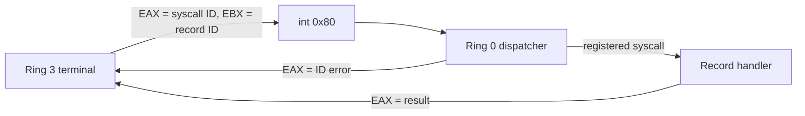

# CYSEOS Phase 2 — Secure System Call Interface

CYSE Operating Systems Phase 2 extends an existing 32-bit x86 teaching kernel with a syscall validation demo. A single interactive Ring 3 terminal submits READ, WRITE, and DELETE requests through `int 0x80`. It displays each validation stage reached and the result returned by the kernel.

## Objectives

- Exercise the Ring 3 to Ring 0 transition with real software interrupts.
- Validate the syscall ID, record argument, and caller's permissions before acting on a request.
- Demonstrate a successful operation, an invalid syscall, an invalid argument, and an authorization failure in one QEMU session.

## Existing kernel and Phase 2 contributions

| Existing infrastructure | Phase 2 contributions |
| --- | --- |
| BIOS/ATA bootloader, 32-bit protected mode, GDT, TSS, IDT, paging, and process/task support | Reused the existing privilege transition and syscall dispatcher, with distinct error results for rejected requests |
| `int 0x80` entry and basic SUM and PRINT services | Added the READ, WRITE, and DELETE handlers, checked the legacy syscall stack arguments, and bounded PRINT string reads |
| FAT16 reader and raw-binary process loader | Used the existing loader for the interactive `blank.bin` program and kept simulated records in kernel memory |
| VGA output and PS/2 keyboard scaffolding | Completed the keyboard-to-process input path and added a Ring 3 command loop with validation feedback |

## System architecture and syscall workflow



At boot, the kernel loads `0:/blank.bin`, assigns permissions to the process, and enters user mode. Keyboard IRQ1 feeds that process's input queue. The terminal polls GETKEY and uses PRINT for VGA output. For record requests, the assembly interrupt wrapper saves registers, passes the interrupt frame to the C handler, and returns to Ring 3 with the result in `EAX`. [Kernel startup](src/kernel.c) · [Interrupt wrapper](src/idt/idt.asm) · [Ring 3 terminal](programs/blank/blank.asm)

The console uses READ (3), DELETE (4), and WRITE (5) for record operations. The dispatcher also registers SUM (0), PRINT (1), and GETKEY (2). [Syscall registration](src/isr80h/isr80h.c)

### Kernel validation

1. **Syscall ID.** The dispatcher checks that the ID is in the range 0 through 1023 and that its table entry has a registered handler. An out-of-range or unregistered ID returns `-EUNIMP` (`-7`). [Dispatcher](src/idt/idt.c)
2. **Argument.** The record handler checks that the ID in `EBX` identifies a record that exists and is still present. A missing or deleted record returns `-EINVARG` (`-2`). [Record handler](src/isr80h/misc.c)
3. **Process permissions.** The handler reads the current task's kernel-owned process permissions. The demo process has READ and WRITE permission and a DELETE grant scoped to record 20. A missing operation permission or a mismatched DELETE grant returns `-EACCES` (`-9`). [Process state](src/task/process.h) · [Grant assignment](src/kernel.c) · [Permission check](src/isr80h/misc.c)

A request stops at its first failed check. The terminal interprets the returned code to show `[PASS]`, `[FAIL]`, and `RESULT:` lines. Malformed input produces a separate `SYNTAX ERROR` before the terminal submits a record request.

## Simulated file environment

The file API uses two volatile, kernel-maintained records, **10** and **20**. Each starts present with a byte value of zero. The existing FAT16 layer loads the user program from the boot disk. The demo's READ, WRITE, and DELETE operations act on the in-memory records.

| Command form | Effect on a valid, authorized request |
| --- | --- |
| `read(id)` | Returns the record's byte as a nonnegative value in `EAX`. The terminal reports success. |
| `write(id)` | Increments the byte, wrapping from 255 to zero. |
| `delete(id)` | Marks the record absent. Subsequent requests for it fail argument validation. |
| `invalid(id)` | Submits unregistered syscall ID 999 to exercise syscall ID validation. The number in parentheses is parsed as the record argument. |

## Ubuntu and QEMU

### Run the bundled image

Install QEMU's x86 system emulator on Ubuntu.

```bash
sudo apt update
sudo apt install qemu-system-x86
```

Run the tested image from the repository root or the extracted submission directory.

```bash
qemu-system-i386 -m 128M -snapshot -drive file=bin/os-phase2.bin,format=raw,if=ide
```

`-snapshot` puts guest disk writes in a temporary overlay. Click the QEMU window, type at the `>` prompt, and press Enter after each command. Close the window or press Ctrl+C in the launching terminal to exit.

### Build from source

The code uses freestanding GNU C, NASM x86 assembly, GNU Make, and GNU linker scripts. Building requires NASM, GNU Make, and a GCC/binutils cross-toolchain targeting `i686-elf`, including `i686-elf-gcc` and `i686-elf-ld`. A full disk-image build also requires loop-mount and VFAT support with `sudo` access.

In a fresh checkout or extraction, install the host tools and put the cross-toolchain on your PATH. The existing `build.sh` expects it under `$HOME/opt/cross/bin`. Substitute your toolchain location if needed.

```bash
sudo apt install build-essential nasm
export PATH="$HOME/opt/cross/bin:$PATH"
command -v i686-elf-gcc i686-elf-ld nasm make
mkdir -p bin build/{disk,fs/fat,gdt,idt,io,isr80h,keyboard,memory/heap,memory/paging,string,task} programs/blank/build
make ./bin/boot.bin ./bin/kernel.bin user_programs
```

The compilation targets produce `bin/boot.bin`, `bin/kernel.bin`, and `programs/blank/blank.bin`. The existing full-image recipe recreates `bin/os.bin` and mounts it temporarily at `/mnt/d` to copy `hello.txt` and `blank.bin`. Use an available mount point at that path for the following commands.

```bash
sudo mkdir -p /mnt/d
make all
qemu-system-i386 -m 128M -snapshot -drive file=bin/os.bin,format=raw,if=ide
```

The bundled `bin/os-phase2.bin` is the verified submission image. The source-build commands were checked using Make's dry-run mode.

## QEMU demonstration and verification

Use a fresh QEMU boot and enter the commands in this order. The records reset on each boot.

| Command | Expected result |
| --- | --- |
| `read(10)` | `SUCCESS` |
| `write(20)` | `SUCCESS` |
| `delete(10)` | `ACCESS DENIED` |
| `read(999)` | `INVALID ARGUMENT` |
| `invalid(999)` | `INVALID SYSCALL ID` |
| `delete(20)` | `SUCCESS` |
| `read(20)` | `INVALID ARGUMENT` after deletion |

The permission test shows all three stages.

```text
> delete(10)
[PASS] Valid syscall ID
[PASS] Valid argument: Record 10
[FAIL] DELETE permission denied
RESULT: ACCESS DENIED
```

The bundled image passed all seven cases in QEMU. A Ring 0 instruction trace confirmed that the DELETE grant check returned `-EACCES` for record 10. Guest memory confirmed that WRITE incremented record 20, the denied DELETE left record 10 present, and the permitted DELETE removed record 20. Additional checks covered `delete(999)` and the separate syntax error for `read(x)`.

Verify the image with `sha256sum bin/os-phase2.bin`. Its SHA-256 is `cdcf8dccbe2e921ce44b164216644c9494d33cd6313ab69fc59d48db8ffe0ef9`.

## Directory structure

```text
.
├── README.md
├── Makefile                    Kernel and disk-image build recipes
├── build.sh                    Cross-toolchain PATH and full-build entry point
├── hello.txt                   Sample file used by the disk-image recipe
├── bin/
│   └── os-phase2.bin            Verified QEMU disk image
├── programs/blank/
│   ├── blank.asm                Interactive Ring 3 test program
│   ├── Makefile
│   └── linker.ld
└── src/
    ├── boot/                    BIOS boot sector
    ├── kernel.c, kernel.asm     Kernel startup and VGA console
    ├── config.h, status.h       Kernel configuration and result codes
    ├── linker.ld                Kernel link layout
    ├── idt/                     Interrupt entry and syscall dispatcher
    ├── isr80h/                  Syscall registration and handlers
    ├── task/                    Task and process state, TSS, and user entry
    ├── keyboard/                PS/2 driver and process input queue
    ├── disk/, fs/               ATA and FAT16 program loading
    └── gdt/, io/, memory/, string/
```

## Known limitations and future improvements

- The console runs a single demo process with startup-assigned permissions and a fixed two-record data set. Future work could support multiple processes and a general per-resource permission policy.
- The records are volatile. Persistent file operations would require additional filesystem support.
- The teaching kernel maps kernel memory into task address spaces with user-read access. Stronger isolation would use supervisor-only kernel mappings and more comprehensive user-memory and exception handling.
- The full-image recipe depends on a privileged mount. An unprivileged image build and automated QEMU regression tests would make future builds easier to reproduce.
